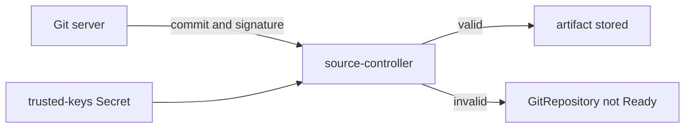

# Verify Commit And Tag Signatures

Anyone who can push to a branch can change what the cluster runs. A signature adds proof of who made a commit. This part shows how a `GitRepository` checks signatures before it stores a revision, and what you see when the check fails.

## What spec.verify checks

A signed commit carries a cryptographic signature made with the author's private key. `spec.verify` makes source-controller check that signature against public keys you trust. It has two fields. `mode` says what to check: `HEAD` verifies the commit that the reference points at, `Tag` verifies the tag object of `ref.tag`, `ref.semver` or `ref.name`, and `TagAndHEAD` verifies both. The lowercase value `head` still works and means the same as `HEAD`. `secretRef.name` names a Secret with the trusted public keys.

## Keys in the Secret

The Secret holds one entry per trusted key. A key with the suffix `.asc` is a PGP (Pretty Good Privacy) public key. A key with the suffix `.sshpub` is an SSH public key in the `authorized_keys` format. One Secret can hold both kinds. A key with any other suffix is read as a PGP keyring for backward compatibility.

Create an SSH key pair and a Secret with the public key. The signature check in this exercise will fail, because the commits in Gitea are not signed, and that failure is what you want to see:

<!-- astrona:playground:renew -->

```sh
kubectl -n gitea exec deploy/tester -- sh -c "rm -f /tmp/author* && ssh-keygen -q -t ed25519 -N '' -C author -f /tmp/author"
kubectl -n gitea exec deploy/tester -- cat /tmp/author.pub > author.sshpub
kubectl -n flux-system create secret generic trusted-keys --from-file=author.sshpub=author.sshpub
```

Save this as `gitrepository-verified.yaml`:

```yaml
apiVersion: source.toolkit.fluxcd.io/v1
kind: GitRepository
metadata:
  name: fleet-verified
  namespace: flux-system
spec:
  interval: 1m
  url: http://gitea.localtest.me:3000/gitops/fleet.git
  ref:
    branch: main
  secretRef:
    name: fleet-auth
  verify:
    mode: HEAD
    secretRef:
      name: trusted-keys
```

Apply it:

```sh
kubectl apply -f gitrepository-verified.yaml
```

Then check the result:

```sh
flux get sources git
flux events --for GitRepository/fleet-verified
```

The `GitRepository` is not ready, and the message says that the commit could not be verified. Note that `secretRef` at the top of `spec` holds the credentials for the Git server, and `verify.secretRef` holds the trusted public keys. They are two different Secrets with two different jobs.

## The condition

The result is recorded in the condition `SourceVerifiedCondition`. Print the conditions:

```sh
kubectl -n flux-system get gitrepository fleet-verified -o jsonpath='{range .status.conditions[*]}{.type}{"\t"}{.status}{"\t"}{.reason}{"\n"}{end}'
```

The condition is `False` with the reason `Failed` when verification fails, and `True` with the reason `Succeeded` when it passes. The success message reports the PGP key ID or the SSH SHA256 fingerprint of the key that matched. When verification fails, source-controller does not store the revision, so no `Kustomization` can apply an unverified commit.



The diagram shows that source-controller compares the signature with the trusted keys before it stores the artifact.

## Key rotation

`status.sourceVerificationFingerprint` holds a fingerprint of the trusted keys. When you change the keys in the Secret, the fingerprint changes and source-controller verifies the current revision again. You do not need to wait for a new commit.

You can now turn on signature checks, name the right Secret and read the result. The next question is what to do when one repository needs the content of another.

## Common pitfalls

> [!WARNING]
> - **Mixing the two Secrets.** `spec.secretRef` is for Git credentials. `spec.verify.secretRef` is for trusted public keys.
> - **A private key in the Secret.** Store the public key only.
> - **A wrong suffix.** `.asc` for PGP, `.sshpub` for SSH. Other suffixes are read as PGP.
> - **Mode `HEAD` with a tag-only workflow.** Use `Tag` or `TagAndHEAD` when you deploy from signed tags.
