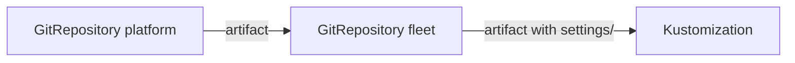

# Submodules And Included Repositories

An application often needs files from a second repository: shared base manifests, a library of templates or settings owned by another team. Git offers submodules for this, and Flux offers `spec.include`. This part sets up both and explains why `include` is usually the better fit in a cluster.

## Git submodules

A Git submodule is a pointer from one repository to a specific commit of another. The parent repository stores only the pointer. By default source-controller ignores submodules, so the artifact contains an empty directory where the submodule would be. Set `spec.recurseSubmodules: true` and source-controller initializes every submodule with default settings. The value is `false` by default.

Turn it on for `fleet` and read what source-controller recorded:

<!-- astrona:playground:renew -->

```sh
kubectl -n flux-system patch gitrepository fleet --type=merge -p '{"spec":{"recurseSubmodules":true}}'
flux reconcile source git fleet
kubectl -n flux-system get gitrepository fleet -o jsonpath='{.status.observedRecurseSubmodules}{"\n"}'
```

The repository `fleet` has no submodules, so nothing else changes, and `status.observedRecurseSubmodules` is `true`. This field shows which setting built the current artifact. The authentication rule for submodules is the problem: the credentials of the `GitRepository` are used for the submodules too. A deploy key works for one repository only, so it cannot fetch the submodules. Use HTTPS with a token, or an SSH key of a bot user that can read the main repository and every submodule.

## include

`spec.include` copies the artifact of another `GitRepository` into this one. Each entry names the other object in `repository.name`, an optional `fromPath` inside it and a `toPath` where the files go in this artifact. The default for `toPath` is the name of the repository.

First create a `GitRepository` for the second repository. Save this as `gitrepository-platform.yaml`:

```yaml
apiVersion: source.toolkit.fluxcd.io/v1
kind: GitRepository
metadata:
  name: platform
  namespace: flux-system
spec:
  interval: 1m
  url: http://gitea.localtest.me:3000/gitops/platform.git
  ref:
    branch: main
  secretRef:
    name: fleet-auth
```

Apply it:

```sh
kubectl apply -f gitrepository-platform.yaml
```

Then include it in `fleet`, under the directory `settings`:

```sh
kubectl -n flux-system patch gitrepository fleet --type=merge -p '{"spec":{"include":[{"repository":{"name":"platform"},"fromPath":"podinfo-settings","toPath":"settings"}]}}'
flux reconcile source git fleet
kubectl -n flux-system get gitrepository fleet -o jsonpath='{.status.observedInclude}{"\n"}'
```

The artifact of `fleet` now holds the files of `podinfo-settings` under `settings/`. The status field `observedInclude` shows the include setting that built the artifact.

## Why include beats submodules here

With `include`, each repository has its own object, so each can have its own Secret, its own interval and its own status. A new commit in `platform` makes `fleet` build a new artifact, while a submodule changes only when someone commits a new pointer. Several repositories can also share one clone. The price is that `fleet` depends on `platform`: if `platform` is not ready, `fleet` reports the condition `IncludeUnavailable`.



The diagram shows that the artifact of `platform` is copied into the artifact of `fleet`.

You can now pull a second repository into an artifact in two ways and tell which one to choose. The artifact is getting larger, so the next part shows how to fetch less.

## Common pitfalls

> [!WARNING]
> - **Expecting submodule content without `recurseSubmodules`.** The directory stays empty.
> - **Using a deploy key for submodules.** One key cannot read two repositories on most Git providers.
> - **A wrong `fromPath`.** The path is inside the artifact of the included repository, not in your own.
> - **Forgetting the dependency.** A broken included repository makes the main one report `IncludeUnavailable`.
