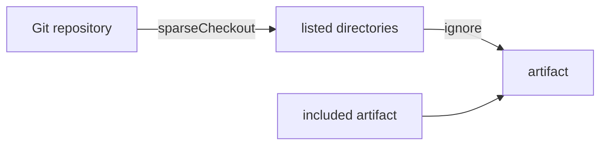

# Sparse Checkout And Smaller Artifacts

A monorepo can hold thousands of files, and a cluster may need only a few directories. Every extra file makes the artifact larger and the clone slower, and a change in an unrelated directory creates a new revision. This part limits the checkout and compares the three ways to shrink an artifact.

## Fetch only some directories

`spec.sparseCheckout` is a list of directories. Only those directories are present in the artifact. Look at the files of the current artifact first. The helper pod runs in `flux-system` because the Flux network policies block other namespaces:

<!-- astrona:playground:renew -->

```sh
ARTIFACT_URL="$(kubectl -n flux-system get gitrepository fleet -o jsonpath='{.status.artifact.url}')"
kubectl -n flux-system run artifact-reader --rm -i --restart=Never --quiet --image=nicolaka/netshoot:v0.13 -- sh -c "curl -s '$ARTIFACT_URL' | tar -tzf -"
```

The list shows `apps`, `clusters` and `docs`. Now keep only `apps`:

```sh
kubectl -n flux-system patch gitrepository fleet --type=merge -p '{"spec":{"sparseCheckout":["apps"]}}'
flux reconcile source git fleet
kubectl -n flux-system get gitrepository fleet -o jsonpath='{.status.observedSparseCheckout}{"\n"}'
```

Run the first command again after the reconcile. The listing contains only `apps`. `status.observedSparseCheckout` shows the list that built the artifact. The Flux `Kustomization` `podinfo` still works, because it uses `./apps/podinfo`.

## A directory that does not exist

Sparse checkout names directories, so a wrong name gives an artifact without the files you need. Change the list to a name that is not in the repository:

```sh
kubectl -n flux-system patch gitrepository fleet --type=merge -p '{"spec":{"sparseCheckout":["app"]}}'
flux reconcile source git fleet
flux reconcile kustomization podinfo
flux get kustomizations
```

The `GitRepository` itself may stay ready, but the `Kustomization` reports that the path `./apps/podinfo` was not found in the artifact. The fault shows in the object that consumes the artifact, not in the one that built it. Set the list back to `["apps"]` before you continue.

## Three tools, three jobs

`spec.ignore` removes files by pattern in `.gitignore` format, inside the files that were fetched. It does not reduce what Git downloads. `sparseCheckout` limits the directories that are checked out, so it reduces the clone and the artifact. `spec.include` adds content from another repository. A `.sourceignore` file in the repository works like `spec.ignore`.

| Field | Effect |
| --- | --- |
| `spec.ignore` | Removes files from the artifact by pattern |
| `spec.sparseCheckout` | Checks out only the listed directories |
| `spec.include` | Adds the artifact of another `GitRepository` |

Use `sparseCheckout` when you need a few directories of a large repository. Use `ignore` for files you want out of the artifact but cannot name by directory, such as images.



The diagram shows the order: sparse checkout selects directories, ignore removes files, and included content is added.

You can now shrink an artifact with the right field and find a wrong directory name. The last thing to control is which commit the repository follows.

## Common pitfalls

> [!WARNING]
> - **Assuming `ignore` shrinks the download.** It only removes files from the artifact.
> - **A misspelled directory.** The `GitRepository` can stay ready while the `Kustomization` fails.
> - **Listing a single file.** The list holds directories.
> - **Forgetting that other consumers share the artifact.** Every object that uses the `GitRepository` sees only the listed directories.
