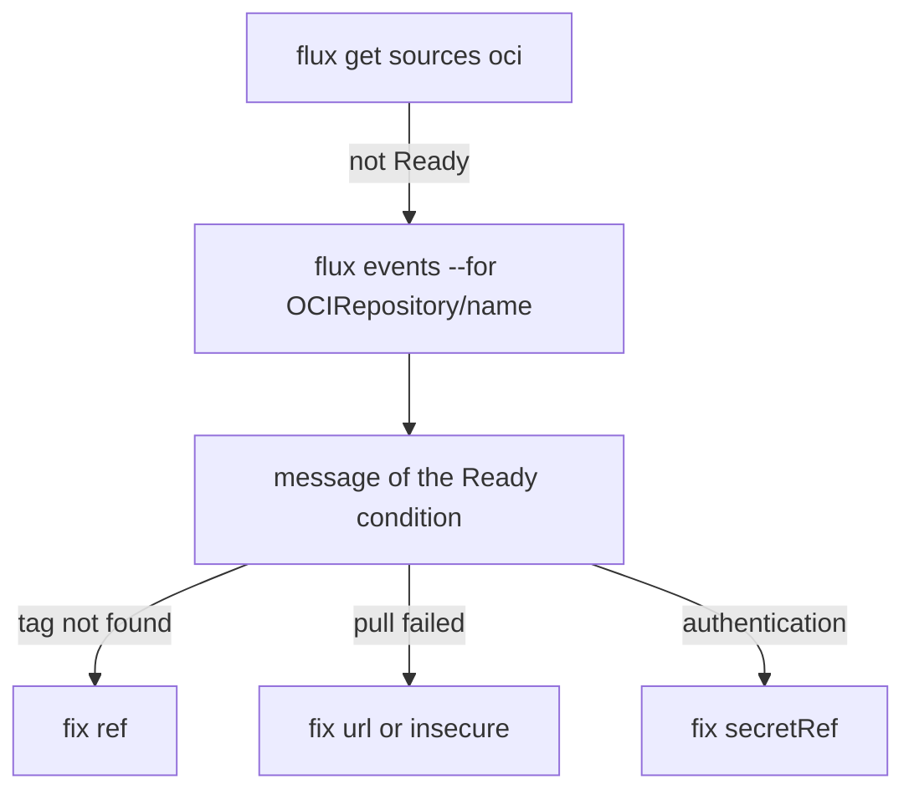

# OCIRepository Status, Conditions And Troubleshooting

An `OCIRepository` that does not fetch is silent from the outside: the Flux `Kustomization` waits and the cluster keeps running the old release. The cause is always written on the object. This part reads the conditions, the events and the artifact metadata, breaks the source three ways on purpose, and shows how to read each error.

## The conditions

Print the conditions of the `OCIRepository` from the previous part:

<!-- astrona:playground:renew -->

```sh
kubectl -n flux-system get ocirepository podinfo -o jsonpath='{range .status.conditions[*]}{.type}{"\t"}{.status}{"\t"}{.reason}{"\n"}{end}'
```

A healthy source has `Ready` and `ArtifactInStorage` as `True`, both with the reason `Succeeded`. `Reconciling` is `True` while a fetch runs, with the reason `Progressing`, or `ProgressingWithRetry` after a failure. `ArtifactOutdated` appears with the reason `NewRevision` while a new revision is being fetched. A failed fetch sets `FetchFailed` to `True` and `Ready` to `False`, with reasons such as `AuthenticationFailed`, `OCIArtifactPullFailed` and `OCIArtifactLayerOperationFailed`. `SourceVerified` is `True` or `False` when `spec.verify` is used. The message of the `Ready` condition has the detail, for example that a tag could not be found.

## The artifact metadata

The artifact carries the annotations that `flux push artifact` wrote. Read them to see which commit a release came from:

```sh
kubectl -n flux-system get ocirepository podinfo -o jsonpath='{.status.artifact.metadata}{"\n"}{.status.artifact.revision}{"\n"}'
```

The metadata holds `org.opencontainers.image.source`, `org.opencontainers.image.revision` and `org.opencontainers.image.created`. When the revision annotation is set, source-controller also puts its value in the events as `originRevision`, which notifications can use.

## Break it three ways

Change one thing at a time and read the message each time. First point the source at a tag that does not exist:

```sh
kubectl -n flux-system patch ocirepository podinfo --type=merge -p '{"spec":{"ref":{"tag":"9.9.9"}}}'
flux reconcile source oci podinfo
flux events --for OCIRepository/podinfo
```

The source is not ready and the message says that the tag could not be found. The Flux `Kustomization` still shows the last good revision, and the cluster keeps running. Put the tag back, then misspell the repository name:

```sh
kubectl -n flux-system patch ocirepository podinfo --type=merge -p '{"spec":{"ref":{"tag":"1.0.0"},"url":"oci://registry.localtest.me:5001/podinfo-manifest"}}'
flux reconcile source oci podinfo
flux events --for OCIRepository/podinfo
```

This time the message names a failed pull of the address, because the registry has no such repository. Restore the address and remove `insecure`:

```sh
kubectl -n flux-system patch ocirepository podinfo --type=merge -p '{"spec":{"url":"oci://registry.localtest.me:5001/podinfo-manifests","insecure":null}}'
flux reconcile source oci podinfo
flux events --for OCIRepository/podinfo
```

The registry speaks plain HTTP and the client now asks for HTTPS, so the pull fails. Put `insecure: true` back and the source is ready again. A real registry uses HTTPS and does not need the field.



The diagram shows the loop: start from the state, read the message, and fix the field the message points at.

## Reconcile on demand

`flux reconcile source oci podinfo` asks source-controller to fetch now, without waiting for the interval. Add `--with-source` to a Flux `Kustomization` reconcile to refresh its source first:

```sh
flux reconcile kustomization podinfo --with-source
```

You can now find why an `OCIRepository` does not fetch, from the message and not from guesses. The next part shapes which tags and which content a working source takes.

## Common pitfalls

> [!WARNING]
> - **Changing several fields at once.** The second error hides behind the first, and you cannot tell which change worked.
> - **Reading only `flux get`.** The row gives a short message; the full reason is in the events and in the `Ready` condition.
> - **Expecting the cluster to stop.** A failed fetch keeps the last artifact, so the workload stays on the old release.
> - **Forgetting `insecure` on a plain HTTP registry.** The error looks like a network problem, but the address is correct.

## Your mission: Repair An OCIRepository That Does Not Fetch

You can now read the state of an `OCIRepository`. The graded lab gives you a source that fails for three reasons, and asks you to find each one from the conditions and events and fix it in place.

The lab runs in its own cluster, so first pause your playground. Nothing in it is lost:

```sh
astrona stop ats-095-playground-020-01
```

Then start the lab:

```sh
astrona run --git ssh://git@github.com/astrona-io/ATS095.git -c sections/section-020/module-01/labs/lab-02
```

The task is on the next page. Solve it on your own first. When you think you are done, send it for grading:

```sh
astrona submit -c sections/section-020/module-01/labs/lab-02
```

When the lab is done, remove it and start your playground again:

```sh
astrona destroy ats-095-lab-020-01-02
astrona start ats-095-playground-020-01
```
