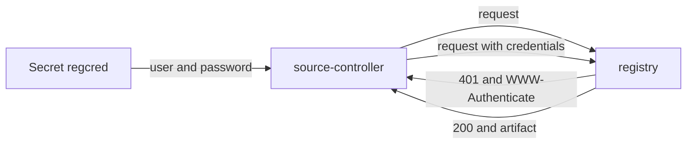

# Registry Credentials With A Pull Secret

A private registry answers every request without credentials with the status 401 and a header that says how to sign in. This part shows that answer, creates a pull secret, and connects it to an `OCIRepository`.

## What the registry says

Ask the registry for its root, once without and once with credentials. Both commands need the port-forward:

<!-- astrona:playground:renew -->

```sh
curl -si http://registry.localtest.me:5001/v2/ | head -5
curl -si -u flux:registry-password http://registry.localtest.me:5001/v2/ | head -1
```

The first answer is `401 Unauthorized` with a `WWW-Authenticate` header that names the scheme, `Basic`. The second answer is `200 OK`. Source-controller sends the same kind of request. Without a Secret it sends none, so it gets the 401.

## Create the pull secret

`flux create secret oci` writes a Secret of the type `kubernetes.io/dockerconfigjson`. The `--url` is the registry address without a scheme or path, and it must match the host and port in the `url` of the `OCIRepository`:

```sh
flux create secret oci regcred -n flux-system --url=registry.localtest.me:5001 --username=flux --password=registry-password
kubectl -n flux-system get secret regcred -o jsonpath='{.type}{"\n"}'
```

The type is `kubernetes.io/dockerconfigjson`. The Secret holds one key, `.dockerconfigjson`, a JSON document with the registry address and the sign-in. Decode it to see the shape, and remember that base64 is not encryption:

```sh
kubectl -n flux-system get secret regcred -o jsonpath='{.data.\.dockerconfigjson}' | base64 -d
```

## Use it from the OCIRepository

First create the source without the Secret and read the failure. Save this as `ocirepository-private.yaml`:

```yaml
apiVersion: source.toolkit.fluxcd.io/v1
kind: OCIRepository
metadata:
  name: podinfo
  namespace: flux-system
spec:
  interval: 1m
  url: oci://registry.localtest.me:5001/podinfo-manifests
  insecure: true
  ref:
    tag: 1.1.0
```

Apply it and read the state:

```sh
kubectl apply -f ocirepository-private.yaml
flux get sources oci
flux events --for OCIRepository/podinfo
```

The source is not ready and the message says that the request was not authorized. Now name the Secret:

```sh
kubectl -n flux-system patch ocirepository podinfo --type=merge -p '{"spec":{"secretRef":{"name":"regcred"}}}'
flux reconcile source oci podinfo
flux get sources oci
```

The revision is `1.1.0@sha256:` and the digest. The Secret must be in the same namespace as the `OCIRepository`.

## A wrong password

A Secret with a wrong password gives an error of the same kind as a missing Secret, so check the Secret as well as the field. Replace the Secret with a wrong password and read the event:

```sh
kubectl -n flux-system delete secret regcred
flux create secret oci regcred -n flux-system --url=registry.localtest.me:5001 --username=flux --password=wrong
flux reconcile source oci podinfo
flux events --for OCIRepository/podinfo
```

Source-controller reports the authentication failure through the condition `FetchFailed` with the reason `AuthenticationFailed`. Put the right password back before you continue.



The diagram shows the exchange: the registry challenges, and source-controller answers with the credentials from the Secret.

You can now sign in to a registry from one `OCIRepository`. The next part avoids repeating the Secret on every object.

## Common pitfalls

> [!WARNING]
> - **A Secret in another namespace.** It is looked up in the namespace of the `OCIRepository`.
> - **An address that does not match.** `--url` and the `url` of the source must use the same host and port.
> - **Reading 401 as a network problem.** The registry answered; it wants credentials.
> - **Committing the Secret as plain YAML.** Encrypt it with SOPS or use an external secret store.
