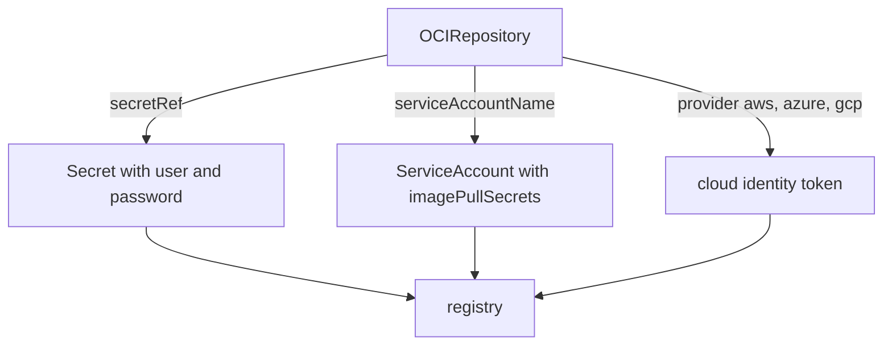

# ServiceAccount And Cloud Identity

A `secretRef` on every `OCIRepository` repeats the same Secret many times. A service account can carry the pull secret once, and the cloud providers can remove the stored password altogether. This part covers both, and says which pieces cannot run in this playground.

## One ServiceAccount, many sources

`spec.serviceAccountName` names a service account in the namespace of the `OCIRepository`. Source-controller reads the `imagePullSecrets` of that account and uses them to sign in. Create an account that holds the pull secret, and remove `secretRef` from the source:

<!-- astrona:playground:renew -->

```sh
flux create secret oci regcred -n flux-system --url=registry.localtest.me:5001 --username=flux --password=registry-password
kubectl -n flux-system create serviceaccount registry-reader
kubectl -n flux-system patch serviceaccount registry-reader --type=merge -p '{"imagePullSecrets":[{"name":"regcred"}]}'
kubectl -n flux-system patch ocirepository podinfo --type=merge -p '{"spec":{"secretRef":null,"serviceAccountName":"registry-reader"}}'
flux reconcile source oci podinfo
flux get sources oci
```

The source is ready again. Every object that names `registry-reader` now shares one Secret, and a password change happens in one place. The `secretRef` field and the service account can be used together; if both are set, the Secret in `secretRef` is tried first.

## Cloud registries

AWS, Azure and Google Cloud issue short-lived tokens to workloads, so no password has to be stored. `spec.provider` tells source-controller which cloud to ask: `aws` for Amazon ECR, `azure` for Azure Container Registry and `gcp` for Google Artifact Registry. The default is `generic`, which uses the Secret or the service account as in this module. The cloud credentials come from the identity of the pod or of a service account, for example IAM roles for service accounts on AWS, Microsoft Entra Workload ID on Azure and Workload Identity Federation on Google Cloud.

```yaml
spec:
  provider: aws
  url: oci://123456789012.dkr.ecr.eu-west-1.amazonaws.com/podinfo-manifests
```

The `kind` playground has no cloud identity, so this part is reading only. What carries over is the rule: the cloud is chosen by `provider`, and the identity is attached to the service account, so no password sits in a Secret.

Flux can also use a generic workload identity for the `generic` provider, with annotations such as `credential.auth.fluxcd.io/provider` on the service account. Treat that as an advanced topic and read the current docs before using it.



The diagram shows three ways to reach the same registry: a Secret, a service account that holds a Secret, and a cloud identity.

You can now choose how a source gets its credentials. The lab uses the plain `secretRef` form.

## Common pitfalls

> [!WARNING]
> - **A service account in another namespace.** It must be in the namespace of the source.
> - **Forgetting `imagePullSecrets` on the account.** The account then has no credentials to share.
> - **Setting a cloud `provider` without an identity.** The pull fails with an authentication error.
> - **Mixing up `provider` and `secretRef`.** The `provider` is for cloud tokens; a password goes in a Secret.

## Your mission: Sign In To A Private Registry

You can now read a registry sign-in failure and fix it. The graded lab gives you a registry that requires a sign-in, an `OCIRepository` without credentials and a Secret with a wrong password, and asks you to repair both.

The lab runs in its own cluster, so first pause your playground. Nothing in it is lost:

```sh
astrona stop ats-095-playground-020-02
```

Then start the lab:

```sh
astrona run --git ssh://git@github.com/astrona-io/ATS095.git -c sections/section-020/module-02/labs/lab-01
```

The task is on the next page. Solve it on your own first. When you think you are done, send it for grading:

```sh
astrona submit -c sections/section-020/module-02/labs/lab-01
```

When the lab is done, remove it and start your playground again:

```sh
astrona destroy ats-095-lab-020-02
astrona start ats-095-playground-020-02
```
