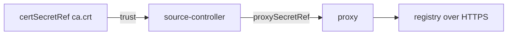

# TLS Certificates And Proxies

The playground registry uses plain HTTP, but production registries use HTTPS, often with a certificate from a private certificate authority, behind a proxy. This part shows the fields for both. You create the Secrets and read their keys here; a real TLS handshake needs a TLS registry, which the playground does not run.

## A private certificate authority

A **certificate authority** (CA) is the party that signs server certificates. If the registry certificate is signed by a CA that is not in the public trust list, source-controller must be told to trust it. `spec.certSecretRef` names a Secret with these keys: `ca.crt` for the CA certificate, and `tls.crt` and `tls.key` for a client certificate when the registry asks for one (mutual TLS). The Secret can hold only `ca.crt`.

Create such a Secret from a throwaway CA, so you can see the shape:

<!-- astrona:playground:renew -->

```sh
openssl req -x509 -newkey ec -pkeyopt ec_paramgen_curve:prime256v1 -nodes -days 1 -subj "/CN=lab-ca" -keyout /tmp/lab-ca.key -out /tmp/lab-ca.crt
kubectl -n flux-system create secret generic registry-tls --from-file=ca.crt=/tmp/lab-ca.crt
kubectl -n flux-system get secret registry-tls -o jsonpath='{.data}' | jq 'keys'
```

Name it in the source:

```yaml
spec:
  url: oci://registry.example.com/podinfo-manifests
  certSecretRef:
    name: registry-tls
```

Do not apply this to the playground source. `insecure: true` and `certSecretRef` do different jobs: the first allows plain HTTP, the second adds trust for HTTPS. Never use `insecure` to get around a certificate error.

## Proxies

`spec.proxySecretRef` names a Secret with the key `address` and, if the proxy asks for a sign-in, `username` and `password`. Create one to see the keys:

```sh
kubectl -n flux-system create secret generic registry-proxy --from-literal=address=http://proxy.example.com:3128
kubectl -n flux-system get secret registry-proxy -o jsonpath='{.data}' | jq 'keys'
```

Only the `OCIRepository` that names the Secret uses the proxy. Other sources and the cluster-wide variables `HTTP_PROXY` and `NO_PROXY` of the controller are not changed.

## Timeouts

`spec.timeout` limits one fetch and defaults to 60 seconds. Raise it for a slow registry or a large artifact, and read the reason in the events when a fetch ends with a timeout.

| Field | Job |
| --- | --- |
| `secretRef` | Sign-in for the registry |
| `certSecretRef` | CA and client certificate |
| `proxySecretRef` | Proxy address and sign-in |
| `timeout` | Maximum time of one fetch |
| `insecure` | Allow plain HTTP |



The diagram shows that the proxy is used for the connection and the CA is used to check the certificate.

You can now name the Secrets for a private CA and for a proxy. The last part adds proof that a release is genuine.

## Common pitfalls

> [!WARNING]
> - **Using `insecure` for a certificate error.** Add the CA with `certSecretRef` instead.
> - **A wrong key name.** The keys are `ca.crt`, `tls.crt` and `tls.key`; other names are ignored.
> - **Forgetting the proxy `address`.** The Secret is unusable without it.
> - **A Secret with a private CA key.** Only the CA certificate is needed.
