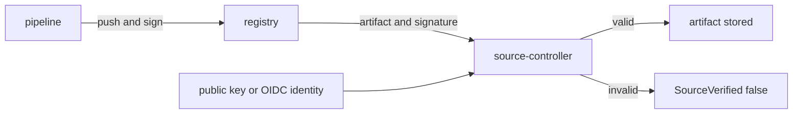

# Verify Signatures With cosign

A sign-in proves who is reading. A signature proves who wrote. **cosign** is a tool of the Sigstore project that signs OCI artifacts and stores the signature next to the artifact in the registry. With `spec.verify`, source-controller checks the signature before it stores the artifact, so an unsigned or wrongly signed release never reaches the cluster.

## Turn on verification

`spec.verify.provider` is `cosign` or `notation`. For cosign with a key pair, `spec.verify.secretRef` names a Secret with the public key under a key that ends in `.pub`. Create a throwaway key pair and a Secret, to see a failed verification. The release in the registry is not signed, so the check must fail:

<!-- astrona:playground:renew -->

```sh
openssl ecparam -name prime256v1 -genkey -noout -out /tmp/cosign.key
openssl ec -in /tmp/cosign.key -pubout -out /tmp/cosign.pub
kubectl -n flux-system create secret generic cosign-pub --from-file=cosign.pub=/tmp/cosign.pub
kubectl -n flux-system patch ocirepository podinfo --type=merge -p '{"spec":{"verify":{"provider":"cosign","secretRef":{"name":"cosign-pub"}}}}'
flux reconcile source oci podinfo
flux events --for OCIRepository/podinfo
```

The source is not ready. The condition `SourceVerified` is `False` with the reason `VerificationError`, because no valid signature for the digest was found. Source-controller does not store the artifact, so a `Kustomization` can never apply it. Read the condition:

```sh
kubectl -n flux-system get ocirepository podinfo -o jsonpath='{range .status.conditions[*]}{.type}{"\t"}{.status}{"\t"}{.reason}{"\n"}{end}'
```

When verification works, `SourceVerified` is `True` with the reason `Succeeded`. Remove the check to continue:

```sh
kubectl -n flux-system patch ocirepository podinfo --type=merge -p '{"spec":{"verify":null}}'
flux reconcile source oci podinfo
```

## Keyless signing

With keyless signing, the pipeline proves its identity through an OpenID Connect provider instead of holding a private key, and the signature is recorded in a public transparency log. In `spec.verify`, you leave out `secretRef` and describe the identity you accept with `matchOIDCIdentity`, a list of entries with an `issuer` and a `subject`, both regular expressions:

```yaml
spec:
  verify:
    provider: cosign
    matchOIDCIdentity:
      - issuer: "^https://token.actions.githubusercontent.com$"
        subject: "^https://github.com/my-org/my-repo/.*$"
```

The playground has no OIDC provider, so keyless signing is reading only. Use anchored expressions: a loose subject accepts a signature from any repository.

## Notation

`provider: notation` verifies signatures made with the Notary Project. It needs a trust policy and trust store certificates in the Secret named by `secretRef`. Choose it when your organization already signs with Notary.

## What verification protects

The check is on the digest, so a signed tag that is later moved to other content fails. Pair `verify` with a semver range or a fixed tag; the signature then proves that the release you follow is the one your pipeline produced. The status field `sourceVerificationFingerprint` records the identity the check used.



The diagram shows that the signature travels with the artifact and is checked against a key or an identity.

## Common pitfalls

> [!WARNING]
> - **Verifying with the private key.** Put only the public key in the Secret.
> - **Loose identity expressions.** Anchor `issuer` and `subject` with `^` and `$`.
> - **Expecting a signature on the tag.** The signature belongs to the digest.
> - **Turning verification off to make a source ready.** That removes the protection; sign the release instead.
