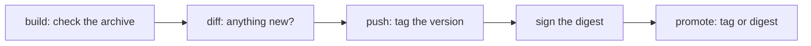

# Sign And Automate In A Pipeline

The commands of the earlier parts become a pipeline when you put them in order and let a machine run them. This part adds a signature to the push, shows where each command belongs, and reads a complete example. The playground has no signing tools or CI system, so this part is for reading.

## Sign the digest

A signature belongs to a digest, not to a tag. That is why `flux push artifact --output json` exists: it gives the pipeline the digest of exactly what was uploaded, and cosign signs that address. The signature is stored in the registry next to the release:

```sh
DIGEST_URL="$(flux push artifact oci://registry.example.com/team/app-config:$TAG \
  --path=./deploy --source="$GIT_URL" --revision="$BRANCH@sha1:$COMMIT" \
  --output json | jq -r '.repository + "@" + .digest')"
cosign sign --key cosign.key "$DIGEST_URL"
```

With a keyless setup, the pipeline signs with its own identity from the CI system and no key file exists. The cluster then checks it with `spec.verify` and `matchOIDCIdentity`, as in the previous module.

## A pipeline in order

A release pipeline has five steps. Each uses a command from this module:



The diagram shows one run of the pipeline: build to check, diff to decide, push to publish, sign to prove the author, promote to move the release on.

```yaml
# Generic outline; adapt the syntax to your CI system.
steps:
  - run: flux build artifact --path=./deploy --output=artifact.tgz
  - run: |
      if flux diff artifact "oci://$REG/app-config:latest-release" --path=./deploy; then
        echo "no change, nothing to push"; exit 0
      fi
  - run: flux push artifact "oci://$REG/app-config:$VERSION" --path=./deploy --source="$GIT_URL" --revision="$BRANCH@sha1:$COMMIT"
  - run: cosign sign --key "$KEY" "$DIGEST_URL"
  - run: flux tag artifact "oci://$REG/app-config:$VERSION" --tag staging
```

The outline is generic and was not run here. Two rules matter more than the syntax. Push a new version tag for every release. Promote with the digest between clusters you want to keep apart.

## Credentials in CI

The CLI reads credentials from `~/.docker/config.json`, so `docker login` or the login action of your CI system works. Without it, `--creds <user>:<password>` passes them directly, and `--provider aws|azure|gcp` logs in with the cloud identity of the runner, so the pipeline holds no password at all. Prefer the provider flag when the runner has an identity.

## Common pitfalls

> [!WARNING]
> - **Signing the tag.** Sign the digest from `--output json`; a tag can move after the signature.
> - **Rebuilding for production.** A second `push` of the same folder with another tag has the same digest only if the content is equal. Promote instead of rebuilding.
> - **Passwords in the command line.** `--creds` shows up in process lists and logs. Use a login step or `--provider`.
> - **Skipping the diff.** Without it, every merge creates a new release even when nothing changed.
