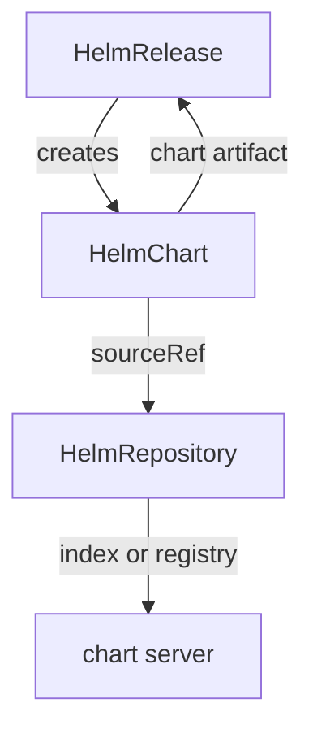

# HelmChart Objects And Chart Versions

A repository holds many charts in many versions; a cluster installs one chart at one version. The `HelmChart` object makes that choice. It names a chart, a version or a range, and the source to take it from, and source-controller stores the resolved chart as an artifact. This part resolves versions with a `HelmChart` you write yourself, and then lets a `HelmRelease` create one for you.

## Resolve a chart from the HTTP repository

A `HelmChart` needs four fields: the `chart` name, the `version` (a fixed version or a semver range; without the field, `*`, the newest), the `sourceRef` and an `interval`. Ask for the newest 6.x podinfo chart from the `HelmRepository` `podinfo`. Save this as `helmchart-podinfo.yaml`:

<!-- astrona:playground:renew -->

```yaml
apiVersion: source.toolkit.fluxcd.io/v1
kind: HelmChart
metadata:
  name: podinfo
  namespace: flux-system
spec:
  interval: 10m
  chart: podinfo
  version: "6.x"
  sourceRef:
    kind: HelmRepository
    name: podinfo
```

Apply it:

```sh
kubectl apply -f helmchart-podinfo.yaml
```

Then check the result:

```sh
flux get sources chart
```

The row for `podinfo` shows `READY` as `True` and a revision that is a chart version starting with `6.`. source-controller looked up the chart in its stored copy of the `index.yaml`, picked the highest version inside `6.x`, downloaded that chart package, and stored it as the artifact. Change the range to an older line and watch the revision follow:

```sh
kubectl -n flux-system patch helmchart podinfo --type=merge -p '{"spec":{"version":"6.14.x"}}'
flux reconcile source chart podinfo
flux get sources chart
```

The revision is now a `6.14` version. The range decides; the `HelmChart` reports the result.

## Resolve the same chart from the OCI registry

The `oci` `HelmRepository` `podinfo-oci` showed no status. A `HelmChart` that uses it is how you find out whether it works. Save this as `helmchart-podinfo-oci.yaml`:

```yaml
apiVersion: source.toolkit.fluxcd.io/v1
kind: HelmChart
metadata:
  name: podinfo-oci
  namespace: flux-system
spec:
  interval: 10m
  chart: podinfo
  version: "6.x"
  sourceRef:
    kind: HelmRepository
    name: podinfo-oci
```

Apply it:

```sh
kubectl apply -f helmchart-podinfo-oci.yaml
```

Then check the result:

```sh
flux get sources chart
```

`podinfo-oci` is `Ready` with a 6.x version too. For an OCI repository, source-controller asks the registry for the tags of `charts/podinfo` and picks the highest that matches, so the chart came straight from the registry without any index.

## Two more fields

A `HelmChart` has two optional fields you meet in real setups. **`reconcileStrategy`** decides when a chart from a `GitRepository` or a `Bucket` counts as new: `ChartVersion`, the default, only when the version in `Chart.yaml` changes; `Revision`, on every new commit or bucket revision. **`valuesFiles`** lists values files inside the chart to merge, in order, with later files overriding earlier ones. When `valuesFiles` is set on a chart from a `HelmRepository`, the revision gets a suffix with the `HelmChart`'s generation, so a change to the list shows up as a new revision.

## The HelmChart a HelmRelease creates

You rarely write a `HelmChart` yourself. A `HelmRelease` describes the chart in `spec.chart.spec`, and helm-controller creates the matching `HelmChart` and waits for source-controller to resolve it. Install podinfo this way. Save this as `helmrelease-podinfo.yaml`:

```yaml
apiVersion: helm.toolkit.fluxcd.io/v2
kind: HelmRelease
metadata:
  name: podinfo
  namespace: flux-system
spec:
  interval: 10m
  releaseName: podinfo
  targetNamespace: podinfo
  chart:
    spec:
      chart: podinfo
      version: "6.x"
      interval: 10m
      sourceRef:
        kind: HelmRepository
        name: podinfo
```

Apply it:

```sh
kubectl apply -f helmrelease-podinfo.yaml
```

Then check the result:

```sh
kubectl get helmcharts -A -o custom-columns=NAMESPACE:.metadata.namespace,NAME:.metadata.name,CHART:.spec.chart,SOURCE:.spec.sourceRef.name,VERSION:.status.artifact.revision
flux get helmreleases
kubectl -n podinfo get deployment podinfo
```

A third `HelmChart` has appeared, one you did not write: helm-controller created it from the `HelmRelease`. It reads the chart `podinfo` from the source `podinfo` and resolved a 6.x version. The `HelmRelease` is `Ready`, and the Deployment `podinfo` runs in the namespace `podinfo`. When a `HelmRelease` cannot find its chart, this list is where you look: find the `HelmChart` with its chart and source, and read why it is not ready.



The diagram shows the chain: helm-controller creates the `HelmChart`, source-controller resolves it through the `HelmRepository`, and helm-controller installs the resulting chart.

You can now resolve a chart version with a `HelmChart`, from an HTTP repository and from a registry, and find the `HelmChart` behind a `HelmRelease`. When a chart does not resolve, you have three places to check, in order: the `HelmRelease`'s chart spec, its `HelmChart`, and the `HelmRepository`.

## Common pitfalls

> [!WARNING]
> - **A range with no match.** `7.x` on a repository that only has 6.x charts leaves the `HelmChart` not ready. Read the revision of a working `HelmChart` to see which versions exist.
> - **Fixing the HelmChart a HelmRelease created.** helm-controller rewrites it from the `HelmRelease`. Change `spec.chart.spec` in the `HelmRelease` instead.
> - **A `sourceRef` that names a repository that does not exist.** The name must match a `HelmRepository` in the same namespace as the `HelmChart`.
> - **Judging an `oci` repository by its own status.** It has none. A `Ready` `HelmChart` that uses it is the proof it works.

## Your mission: Make A Helm Chart Resolve

You can now follow a chart from a `HelmChart` back to its `HelmRepository` and fix what blocks it. The graded lab gives you a `HelmChart` that never resolves because of the `HelmRepository` it reads, and asks you to fix that repository so the chart resolves a 6.x version.

The lab runs in its own cluster, so first pause your playground. Nothing in it is lost:

```sh
astrona stop ats-095-playground-030-01
```

Then start the lab:

```sh
astrona run --git ssh://git@github.com/astrona-io/ATS095.git -c sections/section-030/module-01/labs/lab-01
```

The task is on the next page. Solve it on your own first. When you think you are done, send it for grading:

```sh
astrona submit -c sections/section-030/module-01/labs/lab-01
```

When the lab is done, remove it and start your playground again:

```sh
astrona destroy ats-095-lab-030-01
astrona start ats-095-playground-030-01
```
