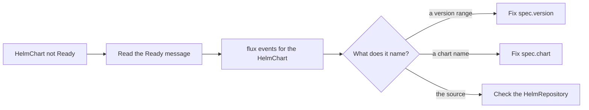

# HelmChart Status, Conditions And Events

A `HelmChart` that does not resolve is the most common Helm source problem, and the object tells you why if you know where to read. Every Flux source reports its state in `status.conditions`, and source-controller writes an event for each important change. This part breaks a `HelmChart` in two different ways and reads the cause from the conditions and the events each time.

## Start with a working repository and a broken chart

A condition is one named yes-or-no fact in the `status` of an object, with a `type`, a `status` of `True`, `False` or `Unknown`, a `reason` in one word and a `message` in plain text. First create the objects. Save this as `helm-sources.yaml`. The `HelmRepository` is valid. The `HelmChart` asks for a version range that the repository does not have:

<!-- astrona:playground:renew -->

```yaml
apiVersion: source.toolkit.fluxcd.io/v1
kind: HelmRepository
metadata:
  name: podinfo
  namespace: flux-system
spec:
  interval: 10m
  url: https://stefanprodan.github.io/podinfo
---
apiVersion: source.toolkit.fluxcd.io/v1
kind: HelmChart
metadata:
  name: podinfo
  namespace: flux-system
spec:
  interval: 10m
  chart: podinfo
  version: "7.x"
  sourceRef:
    kind: HelmRepository
    name: podinfo
```

Apply it and look at both sources:

```sh
kubectl apply -f helm-sources.yaml
flux get sources helm
flux get sources chart
```

The `HelmRepository` is `Ready` and shows the revision of its stored index. The `HelmChart` is not ready, and its message says that no chart version matches the range. The table gives you the summary. The conditions give you the detail.

## Read the conditions

Print every condition of the `HelmChart` with its type, status and reason:

```sh
kubectl -n flux-system get helmchart podinfo -o jsonpath='{range .status.conditions[*]}{.type}{"\t"}{.status}{"\t"}{.reason}{"\n"}{end}'
```

Three condition types matter for a `HelmChart`. `Ready` is `True` only when the artifact is current. `FetchFailed` is `True` when source-controller could not get the chart from the source; its reason is `AuthenticationFailed`, `URLInvalid`, `IllegalPath` or `Failed`. `Stalled` is `True` when the reference itself is invalid; its reason is `InvalidChartReference`, and the controller stops retrying until you change the spec.

While the controller is working or retrying, `Reconciling` is `True` with the reason `Progressing` or `ProgressingWithRetry`. A chart that resolved also carries `ArtifactInStorage`, which means the chart package is stored and ready to be served. A `HelmChart` that failed once and keeps failing is therefore usually `Reconciling` with `ProgressingWithRetry` and `Ready` set to `False` at the same time.

## Read the events

Conditions show the current state. Events show what happened and when. source-controller sends a Kubernetes event on every change of outcome, and `flux events` lists them:

```sh
flux events --for HelmChart/podinfo
```

The newest events name the failure and carry the same message as the `Ready` condition. The message is the line to copy into a search or a ticket, because it names the chart, the version range and the repository that source-controller used.

## Fix the first fault, then meet the second

Change the range to a line that exists and ask for a reconcile. The `patch` command changes only the field you name, and `flux reconcile source chart` asks source-controller to run now instead of waiting for the interval:

```sh
kubectl -n flux-system patch helmchart podinfo --type=merge -p '{"spec":{"version":"6.x"}}'
flux reconcile source chart podinfo
flux get sources chart
```

The `HelmChart` is `Ready` and the revision is a 6.x chart version. Now break it in a different way. Set a chart name that the repository does not publish:

```sh
kubectl -n flux-system patch helmchart podinfo --type=merge -p '{"spec":{"chart":"podinf"}}'
flux reconcile source chart podinfo
flux get sources chart
```

The `HelmChart` is not ready again, and the message now names the chart `podinf` instead of a version range. The two failures look alike in the table and differ in the message, which is why you read the message first and guess second.



The diagram shows the order of the work: read the message, confirm it in the events, and then change the field the message names.

## What an artifact revision tells you

When the `HelmChart` is `Ready`, its `status.artifact.revision` is the chart version. If `valuesFiles` is set on a chart from a `HelmRepository`, the revision gets a suffix made of a plus sign and the `generation` of the `HelmChart`, for example `6.0.3+1`. A changed revision with the same chart version therefore means someone changed the `HelmChart` itself, not the repository.

Put the chart name back so the playground ends in a working state:

```sh
kubectl -n flux-system patch helmchart podinfo --type=merge -p '{"spec":{"chart":"podinfo"}}'
flux reconcile source chart podinfo
```

You can now tell a missing version, a missing chart and a broken source apart from the message of a `HelmChart`, and you know where each lives: in the conditions, in the events, and in the artifact revision. One question remains: how to do the same work faster with the `flux` command-line tool.

## Common pitfalls

> [!WARNING]
> - **Reading only the table.** `flux get sources chart` shows one line of the message. Read the full condition or the events before you change anything.
> - **Waiting for the interval.** After a fix, a `HelmChart` may stay failed until the next interval. Run `flux reconcile source chart` to check the fix now.
> - **Expecting a `Stalled` chart for every typo.** `Stalled` means the reference format is invalid. A chart name that does not exist is a failed fetch that source-controller keeps retrying.
> - **Looking at the `HelmRepository` first.** If the `HelmRepository` is `Ready`, the fault is in the `HelmChart` fields.

## Your mission: Find Why A HelmChart Is Not Ready

You can now read the reason from the conditions and events. The graded lab gives you a `HelmChart` with more than one fault and asks you to find each one from its message and fix it in place.

The lab runs in its own cluster, so first pause your playground. Nothing in it is lost:

```sh
astrona stop ats-095-playground-030-01
```

Then start the lab:

```sh
astrona run --git ssh://git@github.com/astrona-io/ATS095.git -c sections/section-030/module-01/labs/lab-02
```

The task is on the next page. Solve it on your own first. When you think you are done, send it for grading:

```sh
astrona submit -c sections/section-030/module-01/labs/lab-02
```

When the lab is done, remove it and start your playground again:

```sh
astrona destroy ats-095-lab-030-01-02
astrona start ats-095-playground-030-01
```
