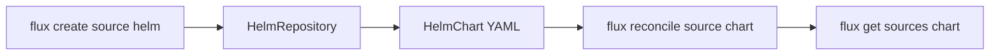

# Managing Helm Sources With The Flux CLI

Flux is meant to be driven from Git, but during an incident or while learning you work with the `flux` command-line tool. It creates, exports, pauses and refreshes Helm sources without editing YAML by hand. This part shows the commands for a `HelmRepository` and a `HelmChart`, and the one thing the tool cannot create.

## Generate a HelmRepository instead of writing it

`flux create source helm` builds a `HelmRepository` from flags. The `--export` flag prints the YAML instead of applying it, which makes the command a generator for files you commit to Git:

<!-- astrona:playground:renew -->

```sh
flux create source helm podinfo \
  --url=https://stefanprodan.github.io/podinfo \
  --interval=10m \
  --export
```

The output is a complete `HelmRepository` in `flux-system` with the `url` and the `interval` you gave. Nothing was created in the cluster. Run the same command without `--export` and the tool applies the object:

```sh
flux create source helm podinfo \
  --url=https://stefanprodan.github.io/podinfo \
  --interval=10m
flux get sources helm
```

The tool waits until the repository is ready and prints the revision of the stored index. The same command also accepts `--secret-ref`, `--username` and `--password` for a repository that needs credentials, and `--cert-file`, `--key-file` and `--ca-file` for TLS. Prefer `--secret-ref` with a Secret you manage, because a password on the command line stays in the shell history.

## The CLI has no command to create a HelmChart

The tool can create a `HelmRepository`, but there is no `flux create source chart`. You write a `HelmChart` as YAML, or you let a `HelmRelease` create it. Apply one now, then use the commands that exist for charts. Save this as `helmchart.yaml`:

```yaml
apiVersion: source.toolkit.fluxcd.io/v1
kind: HelmChart
metadata:
  name: podinfo
  namespace: flux-system
spec:
  interval: 10m
  chart: podinfo
  version: "6.x"
  sourceRef:
    kind: HelmRepository
    name: podinfo
```

```sh
kubectl apply -f helmchart.yaml
flux get sources chart
```

## Reconcile on demand

`flux reconcile source` writes an annotation on the object that tells source-controller to run now. For a `HelmChart` you can also refresh the repository it reads first. Without this, a new chart version in the repository is not seen until the repository interval passes:

```sh
flux reconcile source helm podinfo
flux reconcile source chart podinfo --with-source
```

The second command reconciles the source of the chart before the chart itself. That order matters: a `HelmChart` can only resolve versions that are in the index source-controller already stored.

## Pause and resume

A suspended source keeps its last artifact but stops fetching. Suspend a `HelmRepository` while you investigate, and resume it afterwards:

```sh
flux suspend source helm podinfo
flux get sources helm
flux resume source helm podinfo
```

The table shows the repository as suspended, and the controller ignores it until you resume. `flux resume` also triggers a reconcile.

## Export, list and delete

`flux export source helm` prints the object as YAML with the cluster-specific fields removed, which is how you move an object you created by hand into Git. `flux get sources all` lists the sources of every kind in one table:

```sh
flux export source helm podinfo
flux get sources all
```

Delete a source with `flux delete source helm` and confirm when it asks. Remember that deleting a `HelmRepository` does not delete the `HelmChart` objects that point at it. Those objects stay and report that their source is missing.



The diagram shows the usual order: create the repository with the tool, write the chart as YAML, and then reconcile and read it with the tool.

You can now manage Helm sources from the terminal: generate, apply, refresh, pause, export and delete. The tool changes the cluster only, so anything you want to keep must end up in Git.

## Common pitfalls

> [!WARNING]
> - **Creating an object with the tool and never committing it.** If the same object is managed from Git, the next sync overwrites your change. Use `--export` and commit the file.
> - **Putting passwords on the command line.** Use a Secret and `--secret-ref`.
> - **Forgetting to resume.** A suspended source stays frozen without any error. Check the table for the suspended state.
> - **Reconciling the chart only.** If the new version is not in the stored index yet, add `--with-source` or reconcile the repository first.
