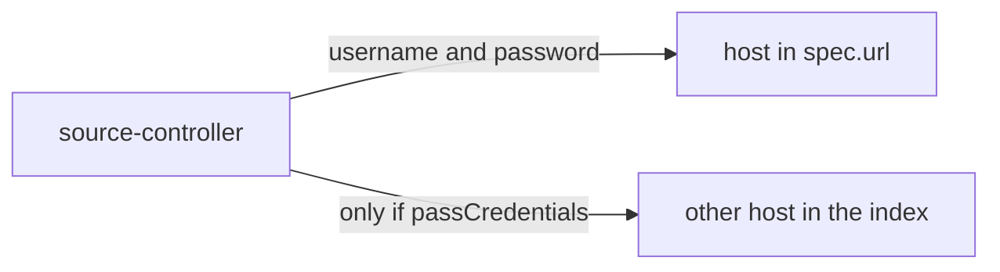

# Credentials And TLS For HTTP Helm Repositories

A private chart server answers `401 Unauthorized` until the client sends credentials. source-controller is the client, so it needs the credentials in a form it can read from the cluster. This part shows how a `HelmRepository` gets a username and password, when it forwards them to other hosts, and how it presents a client certificate.

## Basic authentication from a Secret

Basic authentication sends a username and a password with each request. In Flux the pair lives in a Secret with the keys `username` and `password`. The `HelmRepository` names the Secret in `spec.secretRef.name`, and the Secret must be in the same namespace as the `HelmRepository`.

First point a `HelmRepository` at a Secret that does not exist yet and read the error. Save this as `helmrepository-private.yaml`. The address is the public podinfo repository, which ignores credentials, so the exercise is safe:

<!-- astrona:playground:renew -->

```yaml
apiVersion: source.toolkit.fluxcd.io/v1
kind: HelmRepository
metadata:
  name: private-charts
  namespace: flux-system
spec:
  interval: 10m
  url: https://stefanprodan.github.io/podinfo
  secretRef:
    name: private-charts-auth
```

Apply it:

```sh
kubectl apply -f helmrepository-private.yaml
```

Then check the result:

```sh
flux get sources helm
flux events --for HelmRepository/private-charts
```

The `HelmRepository` is not ready, and the message says that the Secret `private-charts-auth` was not found. source-controller reads the Secret before it makes the first request, so a missing Secret is the first error you see for any private repository.

## Create the Secret

Create the Secret with the keys source-controller expects. The values are lab-only:

```sh
kubectl -n flux-system create secret generic private-charts-auth \
  --from-literal=username=flux \
  --from-literal=password=lab-only-password
flux reconcile source helm private-charts
flux get sources helm
```

The `HelmRepository` is `Ready` now. The public server accepts the request and ignores the credentials. The Flux tool has a helper for the same Secret: `flux create secret helm private-charts-auth --username=flux --password=lab-only-password`. It also takes `--export` to print the YAML instead of applying it.

## passCredentials

A chart repository is an `index.yaml` file, and the chart packages it lists may sit on a different host. By default source-controller sends the credentials only to the host in `spec.url`. When the packages live elsewhere and need the same credentials, set `spec.passCredentials: true`. That sends the credentials to every host the index points at, so use it only when you trust all of them.



The diagram shows that the credentials always go to the host in `spec.url`, and go to other hosts only when `passCredentials` is true.

## Client certificates and a custom CA

Some servers require mutual TLS: the client proves its identity with a certificate. `spec.certSecretRef.name` names a Secret with the keys `tls.crt` and `tls.key`, which must be used together, and an optional `ca.crt` with the certificate authority that signed the server certificate. All files must be PEM-encoded. The Secret type is `Opaque` or `kubernetes.io/tls`. A `HelmRepository` that uses a private authority therefore looks like this:

```yaml
spec:
  url: https://charts.example.com
  secretRef:
    name: private-charts-auth
  certSecretRef:
    name: private-charts-tls
```

Older setups put TLS data in the `secretRef` Secret. That form is deprecated, so write new configuration with `certSecretRef`. Basic authentication and a client certificate can be used together because they travel in separate Secrets.

You can now give a `HelmRepository` a password, decide whether it follows the index to other hosts, and present a client certificate. What remains is the same question for charts stored in an OCI registry, where the credentials follow the Docker format.

## Common pitfalls

> [!WARNING]
> - **The Secret in the wrong namespace.** `secretRef` and `certSecretRef` are looked up in the namespace of the `HelmRepository`.
> - **Wrong key names.** Basic authentication needs `username` and `password`. A certificate needs `tls.crt` and `tls.key`, not `certFile` and `keyFile`.
> - **Turning on `passCredentials` to silence an error.** It sends the password to every host in the index. Fix the cause instead.
> - **Credentials in a Git file.** Commit an encrypted Secret or create it out of band, never plain text.
