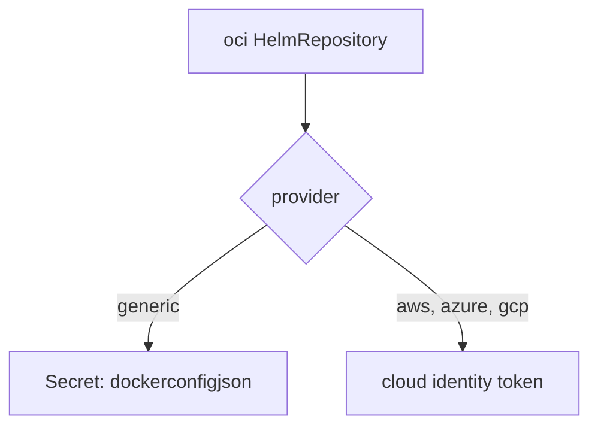

# Credentials For OCI Helm Repositories

A Helm chart stored in a container registry uses the same login as a container image. The registry expects a Docker configuration, not a plain username and password Secret. This part creates that Secret, attaches it to an `oci` `HelmRepository`, and explains the cloud provider field.

## The registry Secret

A registry credential is stored as a Secret of type `kubernetes.io/dockerconfigjson`, which holds a small JSON document with the registry host and an encoded username and password. The Flux tool builds it for you. Print one with `--export` so nothing is created yet:

<!-- astrona:playground:renew -->

```sh
flux create secret oci registry-auth \
  --url=ghcr.io \
  --username=flux \
  --password=lab-only-password \
  --namespace=flux-system \
  --export
```

The output is a Secret named `registry-auth` of type `kubernetes.io/dockerconfigjson`. The `--url` flag is the registry host, without `oci://`. Run the command again without `--export` to create it, and check its type:

```sh
flux create secret oci registry-auth \
  --url=ghcr.io \
  --username=flux \
  --password=lab-only-password \
  --namespace=flux-system
kubectl -n flux-system get secret registry-auth -o jsonpath='{.type}{"\n"}'
```

The type is `kubernetes.io/dockerconfigjson`. You can also create the same Secret with `kubectl create secret docker-registry`. Either way, the `HelmRepository` accepts it, because the Flux documentation lists the Docker configuration Secret as the OCI form.

## Attach it to an oci HelmRepository

Save this as `helmrepository-oci-private.yaml`:

```yaml
apiVersion: source.toolkit.fluxcd.io/v1
kind: HelmRepository
metadata:
  name: podinfo-oci-private
  namespace: flux-system
spec:
  type: oci
  url: oci://ghcr.io/stefanprodan/charts
  secretRef:
    name: registry-auth
```

Apply it:

```sh
kubectl apply -f helmrepository-oci-private.yaml
```

Then check the result:

```sh
kubectl -n flux-system get helmrepository podinfo-oci-private -o jsonpath='{.spec.type}{" "}{.spec.secretRef.name}{"\n"}'
flux get sources helm
```

The object has no status, as for every `oci` `HelmRepository`: source-controller does not contact the registry until a `HelmChart` or a `HelmRelease` needs a chart. The credentials are tested at that moment, so a wrong password shows up on the `HelmChart` and not on the repository.

## provider and insecure

Cloud registries do not use a fixed password. `spec.provider` tells source-controller to get a short-lived token from the cloud instead. Its values are `generic` (the default, which uses the Secret), `aws`, `azure` and `gcp`. It applies to `oci` repositories only. These providers work with the identity of the cloud environment, such as a service account with workload identity, so they cannot run on the `kind` playground and this module teaches them in reading only.



The diagram shows that `generic` reads a Secret and the cloud providers get a token from the environment.

`spec.insecure: true` allows a registry that serves plain HTTP. It is for a lab registry only. A real registry uses HTTPS.

## Maintenance mode

The Flux documentation marks the `oci` type of `HelmRepository` as being in maintenance mode and recommends an `OCIRepository` for new setups that fetch charts from a registry. Existing configurations keep working, and a `HelmRelease` can still use a `HelmRepository` of type `oci`, so you must know its fields for the real world.

You can now create a registry Secret, attach it to an `oci` repository and choose a provider. Charts do not have to come from a repository at all, though: they can be built from a directory in Git.

## Common pitfalls

> [!WARNING]
> - **`oci://` in `--url` of `flux create secret oci`.** Give the host only, such as `ghcr.io`.
> - **Judging the credentials by the repository.** An `oci` `HelmRepository` is never `Ready` or failed. Read the `HelmChart`.
> - **A Secret of the wrong type.** A generic username and password Secret is for the default type. An OCI registry expects the Docker configuration form.
> - **Using `provider: aws` on a local cluster.** It needs the cloud identity and fails on `kind`.
