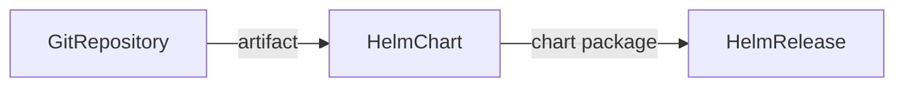

# Charts From Git And Bucket Sources

Teams often keep the chart of their own application in the same Git repository as the code. Publishing it to a chart repository on every change adds a step that Flux can skip: a `HelmChart` can package the chart straight from a `GitRepository` or a `Bucket`. This part builds the podinfo chart from its public Git repository and decides when Flux rebuilds it.

## Point a HelmChart at a GitRepository

The `sourceRef` of a `HelmChart` accepts three kinds: `HelmRepository`, `GitRepository` and `Bucket`. With a Git source, `spec.chart` is no longer a chart name. It is the path of the chart directory inside the repository. Save this as `git-chart.yaml`. The podinfo repository keeps its chart in `charts/podinfo` on the branch `master`:

<!-- astrona:playground:renew -->

```yaml
apiVersion: source.toolkit.fluxcd.io/v1
kind: GitRepository
metadata:
  name: podinfo-git
  namespace: flux-system
spec:
  interval: 10m
  url: https://github.com/stefanprodan/podinfo
  ref:
    branch: master
---
apiVersion: source.toolkit.fluxcd.io/v1
kind: HelmChart
metadata:
  name: podinfo-git
  namespace: flux-system
spec:
  interval: 10m
  chart: ./charts/podinfo
  sourceRef:
    kind: GitRepository
    name: podinfo-git
```

Apply it:

```sh
kubectl apply -f git-chart.yaml
```

Then check the result:

```sh
flux get sources git
flux get sources chart
```

The `GitRepository` fetches the repository and stores an artifact. The `HelmChart` then reads the directory `charts/podinfo` from that artifact, packages it as a chart and stores the package as its own artifact. The revision of the `HelmChart` is the `version` in the `Chart.yaml` file of that directory.

Notice what is missing: `spec.version`. For a Git or Bucket source the field is ignored, because the version comes from `Chart.yaml`.

## reconcileStrategy

If a commit changes a template but the author forgets to raise the `version` in `Chart.yaml`, the chart version stays the same. With the default strategy, `ChartVersion`, source-controller then sees no new chart and builds nothing. Set `reconcileStrategy: Revision` and every new revision of the source produces a new chart artifact. Its revision is the chart version, a plus sign, and the first 12 characters of the source revision. Apply the change:

```sh
kubectl -n flux-system patch helmchart podinfo-git --type=merge -p '{"spec":{"reconcileStrategy":"Revision"}}'
flux reconcile source chart podinfo-git --with-source
flux get sources chart
```

The revision of `podinfo-git` now has a plus sign followed by part of the commit hash. A change of the commit changes the artifact even when the chart version stays the same, so helm-controller sees a new chart every time.

## valuesFiles

`spec.valuesFiles` lists values files inside the source that source-controller merges into the chart's `values.yaml` while it packages the chart. Paths are relative to the source, files merge in list order, and later files override earlier ones. Add a path that does not exist and read the result:

```sh
kubectl -n flux-system patch helmchart podinfo-git --type=merge -p '{"spec":{"valuesFiles":["charts/podinfo/values.yaml","charts/podinfo/values-prod.yaml"]}}'
flux reconcile source chart podinfo-git --with-source
flux get sources chart
```

The second file does not exist in the repository, so the chart is not ready and the message names the missing file. Set `spec.ignoreMissingValuesFiles: true` and source-controller skips files it cannot find. The field `status.observedValuesFiles` then lists the files it used:

```sh
kubectl -n flux-system patch helmchart podinfo-git --type=merge -p '{"spec":{"ignoreMissingValuesFiles":true}}'
flux reconcile source chart podinfo-git --with-source
kubectl -n flux-system get helmchart podinfo-git -o jsonpath='{.status.observedValuesFiles}{"\n"}'
```

## Buckets work the same way

A `Bucket` source behaves like a `GitRepository` here: `spec.chart` is a path in the bucket content, `version` is ignored, and `reconcileStrategy: Revision` rebuilds on every new bucket revision.



The diagram shows that the chart is packaged from the stored source artifact, with no chart repository in between.

You can now build a chart from Git, rebuild it on every commit and merge values files. The next question is whether the chart you fetch is the chart you meant to get.

## Common pitfalls

> [!WARNING]
> - **A chart name in `chart` for a Git source.** It must be a path such as `./charts/podinfo`.
> - **Setting `version` for a Git source.** It is ignored. The version comes from `Chart.yaml`.
> - **Leaving `reconcileStrategy` at `ChartVersion`** and expecting a rebuild on each commit.
> - **A wrong branch in the `GitRepository`.** The chart cannot be read until the source itself is ready.

## Your mission: Fix A HelmChart That Builds From Git

You can now build a chart from a Git source and choose when it is rebuilt. The graded lab gives you a `GitRepository` and a `HelmChart` that fail for several reasons, and asks you to fix them in place.

The lab runs in its own cluster, so first pause your playground. Nothing in it is lost:

```sh
astrona stop ats-095-playground-030-02
```

Then start the lab:

```sh
astrona run --git ssh://git@github.com/astrona-io/ATS095.git -c sections/section-030/module-02/labs/lab-01
```

The task is on the next page. Solve it on your own first. When you think you are done, send it for grading:

```sh
astrona submit -c sections/section-030/module-02/labs/lab-01
```

When the lab is done, remove it and start your playground again:

```sh
astrona destroy ats-095-lab-030-02
astrona start ats-095-playground-030-02
```
