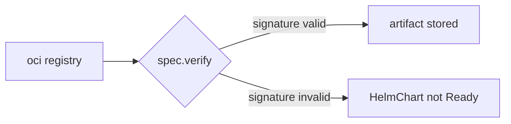

# Verify Chart Signatures And Choose A Chart Source

Fetching a chart over HTTPS proves that the bytes came from the server you named. It does not prove who built the chart. A signature does: the publisher signs the chart with a key, and the consumer checks that signature before it trusts the chart. This part explains how a `HelmChart` verifies a signature, and then compares the three sources a chart can come from.

## What spec.verify does

`spec.verify` is a field of the `HelmChart`. It makes source-controller check the signature of the chart in an OCI registry before it stores the chart. It supports two providers, `cosign` and `notation`. Cosign is a tool that signs and verifies container artifacts. Notation is another signing tool for OCI artifacts. The field only works when the `HelmChart` reads from a `HelmRepository` of type `oci`. A chart from an HTTP repository, a Git repository or a bucket cannot be verified this way.

Look at the field in the cluster's own documentation for the `HelmChart` kind. `kubectl explain` reads it from the custom resource definition (CRD), the object that teaches Kubernetes about the `HelmChart` kind:

<!-- astrona:playground:renew -->

```sh
kubectl explain helmchart.spec.verify
kubectl explain helmchart.spec.verify.matchOIDCIdentity
kubectl explain helmchart.spec.sourceRef.kind
```

The first command lists `provider`, `secretRef` and `matchOIDCIdentity`. The second shows `issuer` and `subject`. The third shows which kinds a `sourceRef` accepts.

## Keys and keyless verification

There are two ways to verify with cosign. With a public key, you store the key in a Secret and set `spec.verify.secretRef.name`. The Secret holds the public key file, for example under the key `cosign.pub`. With keyless signing, there is no key to store: the signature is tied to an identity from an OpenID Connect (OIDC) provider, such as a CI system. You then set `matchOIDCIdentity`, a list of pairs of `issuer` and `subject`, and both are regular expressions. The `subject` names the workflow or user that signed. This option applies to cosign only.

A verified `HelmChart` could look like this. It is shown to read, not to apply, because the chart in the example is not signed with this key:

```yaml
spec:
  chart: podinfo
  sourceRef:
    kind: HelmRepository
    name: podinfo-oci
  verify:
    provider: cosign
    secretRef:
      name: cosign-public-key
```

## What you see when it works or fails

After a successful check the `HelmChart` carries the condition `SourceVerified` with the status `True`, next to `Ready`. When verification fails, the chart is not stored, the `HelmChart` is not ready, and the message names the signature problem. A `HelmChart` never serves a chart that failed verification, so helm-controller cannot install it.



The diagram shows that verification happens before storing the artifact.

## Choosing a chart source

Each source has strengths. Compare them by what you need:

| Source | `chart` holds | Version comes from | Verify |
| --- | --- | --- | --- |
| `HelmRepository` | a chart name | `spec.version` range | OCI only |
| `GitRepository` | a path in the repository | `Chart.yaml` | no |
| `Bucket` | a path in the bucket | `Chart.yaml` | no |

Use a `HelmRepository` for released charts with versions and signatures. Use a `GitRepository` when the chart changes together with the application code and you want a rebuild on each commit. Use a `Bucket` when the charts already live in object storage.

You can now explain which charts can be verified, which Secret or identity the check needs, and how to choose between the three chart sources. This closes the module: from a private repository, through the OCI registry and the Git source, to a signed chart.

## Common pitfalls

> [!WARNING]
> - **Adding `verify` to a chart from an HTTP repository.** Verification works for OCI sources only.
> - **Using `matchOIDCIdentity` with `notation`.** It applies to `cosign` only.
> - **An identity pattern that is too loose.** A subject that matches every workflow accepts any signer.
> - **Treating `SourceVerified` as a guarantee of safety.** It proves who signed the chart, not that the chart is free of mistakes.
