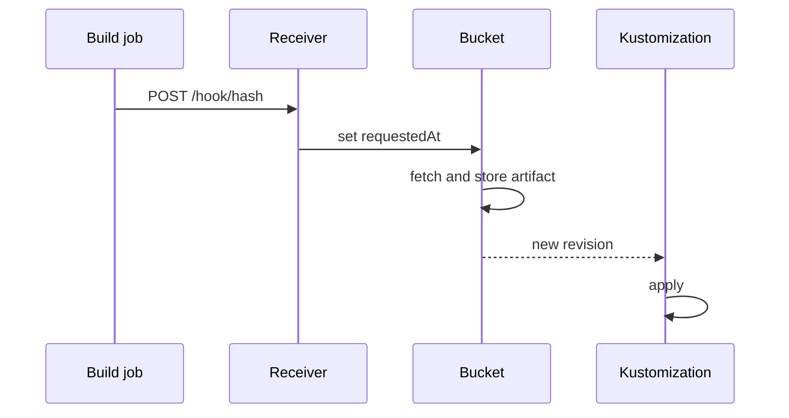

# Receivers: A Webhook That Reconciles A Source

This part builds the smallest working Receiver. First you set up the bucket the way the previous module did. Then you add a Receiver, call its address with `curl`, and watch the source reconcile without a person asking.

## Set up the source

Create the Secret, the `Bucket` with a 30-minute interval and the Flux `Kustomization`:

<!-- astrona:playground:renew -->

```sh
kubectl -n flux-system create secret generic s3-credentials \
  --from-literal=accesskey=flux-s3 --from-literal=secretkey=flux-s3-secret
kubectl apply -f - <<'EOF'
apiVersion: source.toolkit.fluxcd.io/v1
kind: Bucket
metadata:
  name: podinfo
  namespace: flux-system
spec:
  interval: 30m
  bucketName: podinfo
  endpoint: s3.s3.svc.cluster.local:9000
  insecure: true
  secretRef:
    name: s3-credentials
---
apiVersion: kustomize.toolkit.fluxcd.io/v1
kind: Kustomization
metadata:
  name: podinfo
  namespace: flux-system
spec:
  interval: 30m
  path: ./
  prune: true
  wait: true
  timeout: 2m
  sourceRef:
    kind: Bucket
    name: podinfo
EOF
flux get sources bucket
```

## Create the Receiver

A `Receiver` needs three things: a **type**, a **Secret** with a token, and the list of **resources** to reconcile. For the type `generic`, any HTTP `POST` to the right path counts. The token is a string that only you and the caller know. Create it and the Receiver:

```sh
kubectl -n flux-system create secret generic webhook-token \
  --from-literal=token="$(head -c 16 /dev/urandom | od -An -tx1 | tr -d ' \n')"
kubectl apply -f - <<'EOF'
apiVersion: notification.toolkit.fluxcd.io/v1
kind: Receiver
metadata:
  name: podinfo-upload
  namespace: flux-system
spec:
  type: generic
  secretRef:
    name: webhook-token
  resources:
    - apiVersion: source.toolkit.fluxcd.io/v1
      kind: Bucket
      name: podinfo
EOF
kubectl -n flux-system wait receiver/podinfo-upload --for=condition=Ready --timeout=60s
```

The same object can be written with the CLI. `flux create receiver` takes the type, the Secret and one `--resource Kind/name` for each target, and `--export` prints the YAML instead of applying it:

```sh
flux create receiver podinfo-upload --type generic --secret-ref webhook-token \
  --resource Bucket/podinfo --export
```

## Read the webhook path

When the Receiver is Ready, notification-controller has written the path to its status:

```sh
kubectl -n flux-system get receiver podinfo-upload -o jsonpath='{.status.webhookPath}{"\n"}'
```

The path has the form `/hook/` followed by a long hash. The hash is computed from the token, the name and the namespace of the Receiver, so it is not guessable, and it changes when you change the token. The path **is** the secret for a `generic` Receiver: anyone who knows it can trigger a reconcile.

## Call the webhook

notification-controller exposes its receiver port as the Service `webhook-receiver` in `flux-system`, on port 80. Upload a change, then call the path from the client pod:

```sh
kubectl -n s3 exec deploy/s3-client -- aws s3 cp s3://podinfo/deployment.yaml - \
  | sed 's/replicas: [0-9]*/replicas: 3/' \
  | kubectl -n s3 exec -i deploy/s3-client -- aws s3 cp - s3://podinfo/deployment.yaml
HOOK="$(kubectl -n flux-system get receiver podinfo-upload -o jsonpath='{.status.webhookPath}')"
kubectl -n s3 exec deploy/s3-client -- curl -fsS -X POST "http://webhook-receiver.flux-system.svc.cluster.local$HOOK"
```

Within seconds the source and the sync move:

```sh
flux get sources bucket
kubectl -n podinfo get deployment podinfo
kubectl -n flux-system get bucket podinfo -o jsonpath='{.metadata.annotations}' | jq
```

The `Bucket` has a new revision, the Deployment runs 3 replicas, and the annotations of the `Bucket` hold `reconcile.fluxcd.io/requestedAt` with a timestamp that the Receiver wrote. The interval of the `Bucket` is still 30 minutes. The Receiver changed nothing about the schedule; it made one extra request.



The diagram shows the chain from the webhook to the cluster: the call sets the annotation, the source fetches, and the Flux `Kustomization` applies the new revision.

## Common pitfalls

> [!WARNING]
> - **Calling with `GET`.** Receivers expect a `POST`. A `GET` is refused.
> - **A Receiver in another namespace than its targets.** The resources are looked up in the namespace of the Receiver unless you give a namespace in the entry.
> - **Treating the path as public.** For `generic`, the path is the credential. Do not log it or put it in a public build output.
> - **Expecting the interval to change.** Receivers only add requests. The polling schedule stays.
